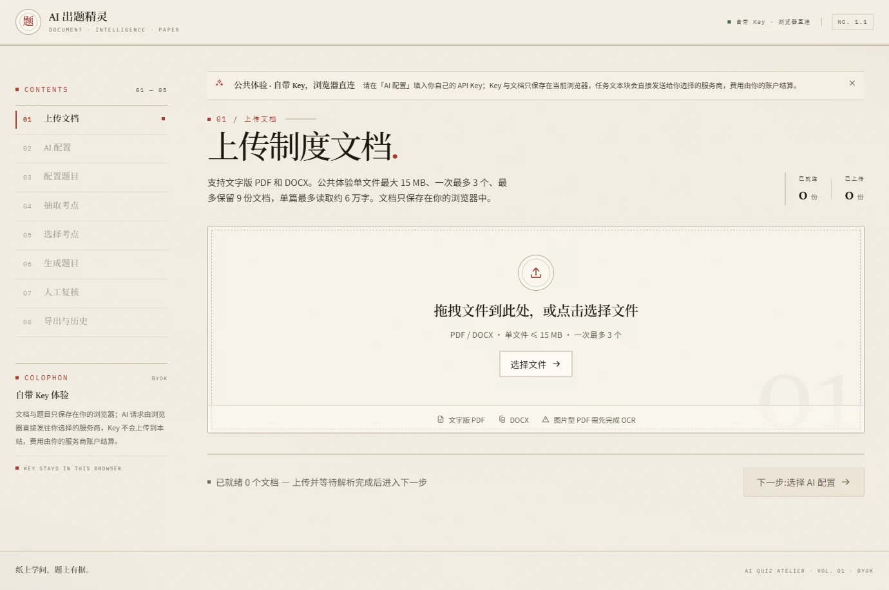
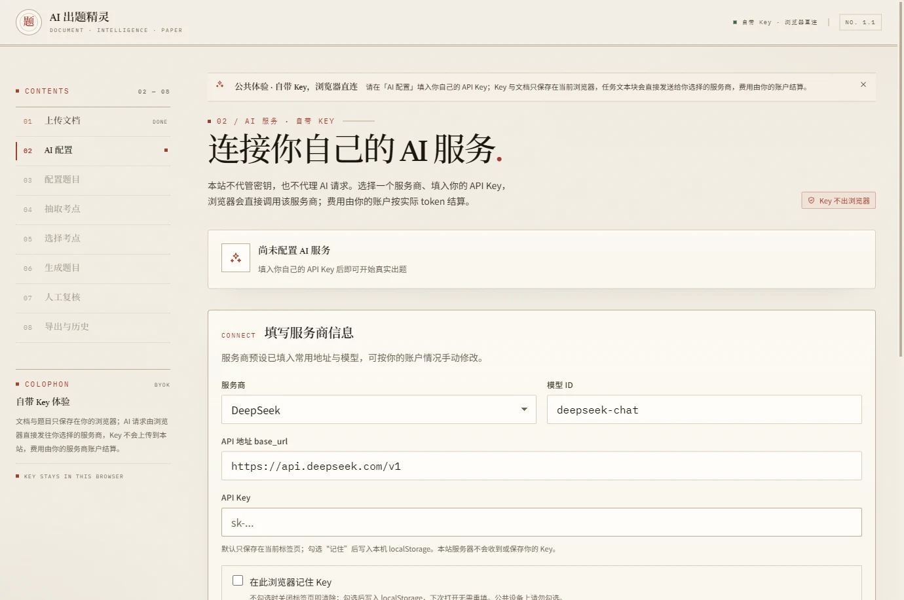
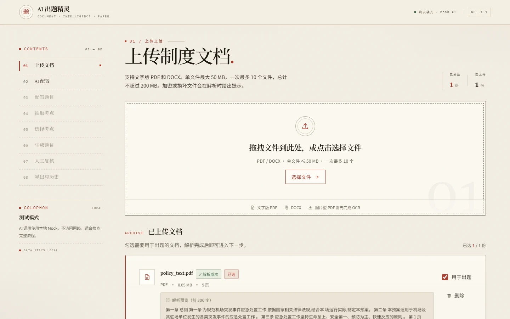
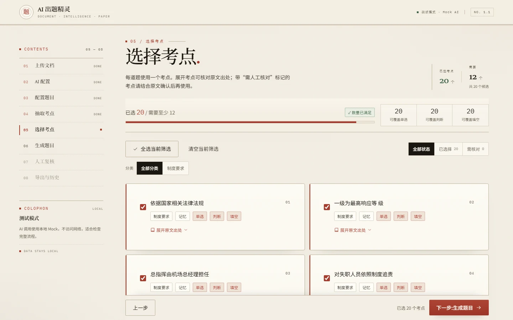
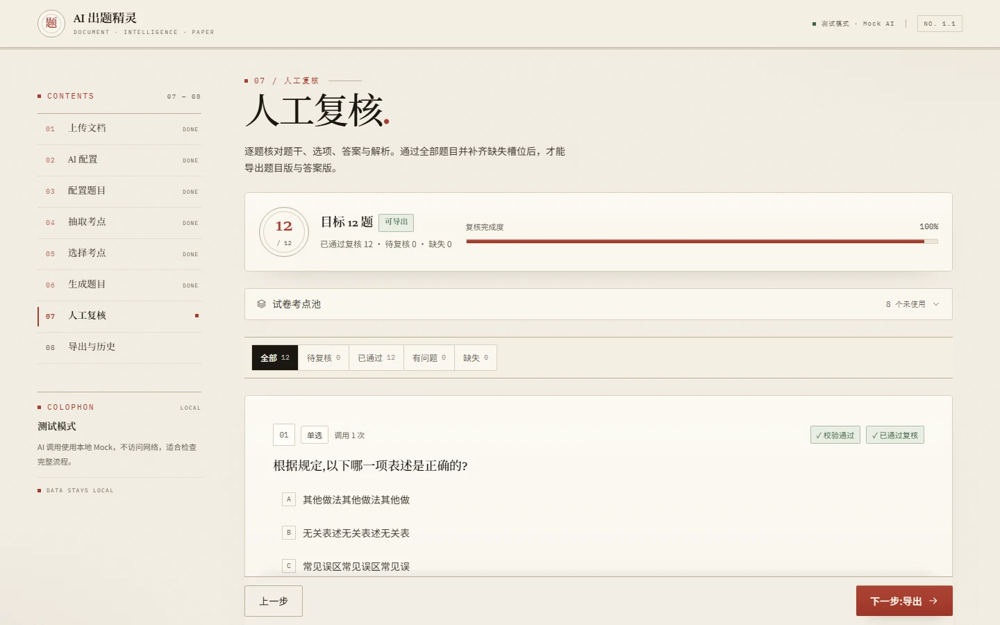
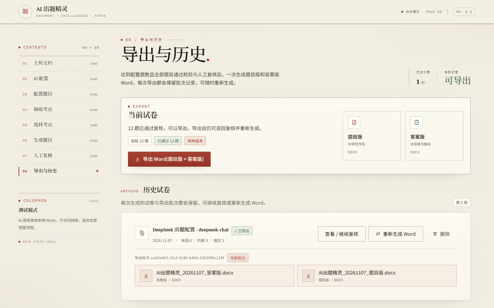
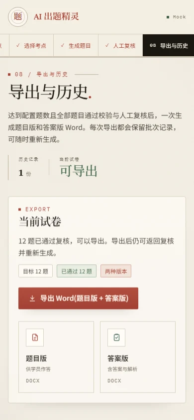
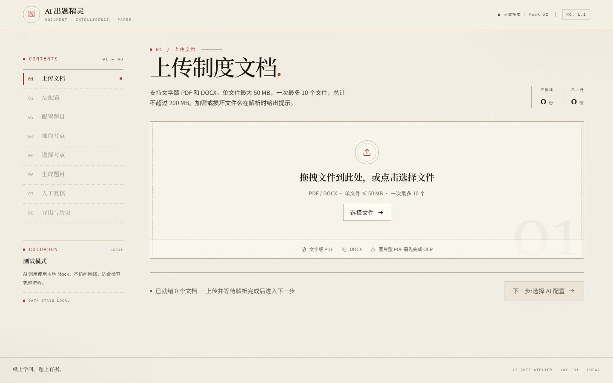
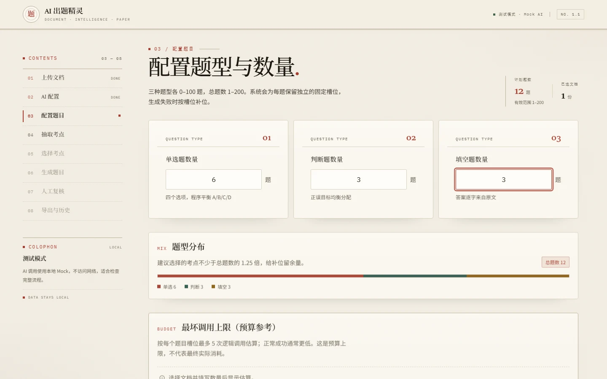
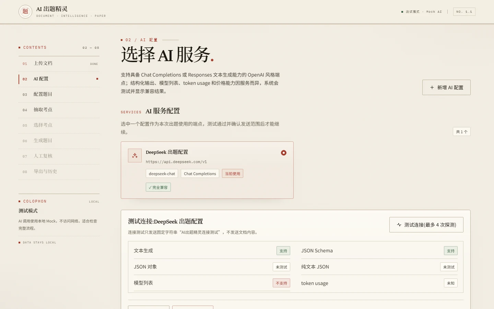

# AI 出题精灵 · Doc2Exam

> 把文字版 PDF / DOCX 制度文档，转换为**可追溯、可复核**的单选题、判断题与填空题，并一次导出题目版与答案版两套 Word 文档。

    

🌐 **[在线体验：doc2exam.dawsondx.top](https://doc2exam.dawsondx.top/)** · 8 步出题流程 · 3 类题型 · 题目版 / 答案版双 Word · 源码与数据均可自托管

| 入口 | 地址 |
| --- | --- |
| **在线体验（推荐先试）** | <https://doc2exam.dawsondx.top> |
| 源码仓库 | <https://github.com/dawsondx/Doc2Exam> |
| 产品与接口规格书 | [`quiz-generator-spec.md`](./quiz-generator-spec.md) |
| 验证报告 | [`VERIFICATION.md`](./VERIFICATION.md) |



*在线站点首屏：纸墨编辑式排版，左侧八步流程导航，右上角标注「自带 Key · 浏览器直连」。*

---

## 一、项目简介

培训、考核与新人考试常常需要把一份内部制度文档人工改写成试卷：逐页阅读、起草题目、核对答案出处，既耗时又容易出错。AI 出题精灵把这条链路改成「**AI 初稿 + 人工复核**」：本地解析文档 → 抽取候选考点 → 用户勾选 → 按固定槽位生成题目 → 程序校验与人工确认 → 导出双版本 Word。

项目坚持三条设计原则：

1. **出处由程序保证**。每道题都挂到程序保存的 `SourceBlock`：PDF 定位到「第 N 页」，DOCX 定位到「标题路径 > 段落 N / 表格 N」。AI 回传的文件名、页码和原文引用一律不被信任。
2. **人工拥有最终决定权**。程序只做可确定的结构与出处校验，不宣称「语义正确」。只有满足配置题数、全部通过程序校验且全部人工通过，才允许导出。
3. **数据边界清晰**。本地版只监听 `127.0.0.1`，业务数据只写入项目 `data/`；公开版为纯静态 BYOK 站点，文档与密钥都留在用户浏览器，不经过任何服务器。

项目提供两种独立形态，源码同仓、界面同源、能力各有侧重：

| | 公开站点版（BYOK） | 本地桌面版（Windows 11） |
| --- | --- | --- |
| 在线地址 | <https://doc2exam.dawsondx.top> | `http://127.0.0.1:8000` |
| 运行位置 | 浏览器内，纯静态 GitHub Pages | 本机 FastAPI + 同源前端 |
| 后端 / 数据库 | 无，数据存 IndexedDB | FastAPI + SQLite（WAL）+ Alembic |
| 文档解析 | `pdfjs-dist` / `mammoth` | `pypdfium2` / `python-docx` |
| AI 调用 | 浏览器直连服务商（需自备 Key） | 后端通过 OpenAI 风格 SDK 调用 |
| AI 协议 | OpenAI 兼容、Anthropic Messages、Gemini generateContent | Chat Completions / Responses |
| Word 导出 | 浏览器内 `docx` 生成 | 服务端 `docxtpl` 真实模板，导出前双向校验 |
| 长任务 | 前端轮询 | 后台 Job + SSE 断点续传 + 中断恢复 |
| 适用场景 | 快速体验、轻量出题 | 正式出卷、大文档、需持久化与复核留痕 |

---

## 二、在线体验

打开 <https://doc2exam.dawsondx.top> 即可使用，**无需安装、无需账号**。首次使用只需在「AI 配置」页填入自己的 API Key（BYOK）。

- **Key 只留在浏览器**：默认存 `sessionStorage`，关闭标签页即清除；勾选「记住」后才写入 `localStorage`。文档、考点、试卷与导出记录存 IndexedDB，均不上传。
- **AI 请求由浏览器直连服务商**，因此所选服务商需允许跨域调用；界面已对不支持的服务商给出提示。
- 内置服务商预设：DeepSeek、Kimi / Moonshot、硅基流动 SiliconFlow、OpenRouter、OpenAI、Anthropic Claude、Google Gemini，以及自定义 / 中转站。默认预设为 DeepSeek + `deepseek-chat`。
- 公共版资源限额（浏览器环境约束）：单文件 ≤ 15 MB、一次最多 3 个、最多保留 9 份文档、单篇约 6 万字、PDF 最多读取 200 页、总题数 ≤ 30 且每类 ≤ 15。需要更大规格请使用本地桌面版。



*BYOK 配置表单：服务商预设、模型 ID、`base_url`、API Key、记住 Key 开关与连接测试；页面明确标注「Key 不出浏览器」。*

> 图片型 PDF 需先自行完成 OCR；站点版与本地版均不做 OCR。

---

## 三、主要功能特性

### 文档解析与出处追溯

- 支持文字版 PDF 与 DOCX，批量上传；本地版单次最多 10 个文件、单文件 ≤ 50 MB、批次 ≤ 200 MB。
- PDF 逐页保留 1-based 页码；DOCX 跟踪 Heading 1–6 形成标题路径，表格按「表格编号 + 行号」定位，不伪造物理页码。
- 确定性切分出 `SourceBlock`（约 800 字符软上限、页尾短块合并），同版本解析器对同一夹具产生相同边界；上传后可预览原文前 300 字。
- 自动识别并明确拒绝扫描件、加密文档、损坏文件与超长文档，错误提示附带下一步动作。



*解析完成后每份文档显示页数 / 大小、解析状态与原文预览，出处信息在此刻由程序固定下来。*

### 两阶段出题

1. **抽取考点**：按 SourceBlock 组块（目标 2,000–4,000 token，预留 30% 上下文余量），AI 返回原子考点；程序做 ID 白名单、长度与题型校验，并按中文 3-gram Jaccard ≥ 0.82 做近似去重（并查集传递闭包 + 固定排序保留首项）。
2. **用户勾选**：按文档、章节 / 页码、分类分组，可展开查看原文，实时显示已选数量与题型可覆盖数量。
3. **生成题目**：先建立固定 `QuestionSlot`（题型与顺序不可被 AI 改写），使用种子化的增广路二分匹配把考点一对一分配给槽位；单选 A/B/C/D 与判断正误数量均做平衡，答案位置由程序决定而非 AI。



*考点卡片带分类、Bloom 层级、可覆盖题型与「展开原文出处」，顶部实时显示已选 / 需求数量与覆盖度。*

### 质量控制

- **程序校验**：题干与解析长度、选项唯一性与长短比、填空恰好一个空且答案出自原文、出处继承正确等；`blocking` 判失败，`warning` 仅提示不阻断。
- **有界重试**：单个槽位最多 5 次逻辑调用（第 4 次更换考点），每次逻辑调用最多 3 次 HTTP 尝试，仅对 408 / 429 / 5xx / 超时重试并遵守 `Retry-After`，绝不无限重试或静默增加成本。
- **人工复核**：编辑、删除、重新生成、通过、驳回、批量通过；编辑后自动重新校验并重置复核状态。导出门槛始终显示「目标 N 题｜已通过｜待复核｜缺失」。
- **Prompt 注入防护**：SourceBlock 被视为不可信数据，系统消息限定输出结构与允许 ID，AI 返回越界 ID 直接拒绝。



*复核页显示目标题数、完成度进度条与「校验通过 / 已通过复核」状态；只有全部通过才能进入导出。*

### 任务可靠性

- 解析、抽取、生成三类长任务统一状态机：`queued → running → completed / partial / failed / cancelled / interrupted`。
- 进度通过 SSE 实时推送，事件持久化并支持 `Last-Event-ID` 断点续传与 15 秒心跳；刷新页面后从后端 `/api/jobs` 恢复，不依赖前端内存或 `localStorage`。
- 每完成一个执行单元即提交数据库，程序重启后遗留任务标记 `interrupted`，点击「继续任务」只补做未完成单元。
- 创建、重生成、补题与导出均使用 `Idempotency-Key` 保证幂等；同一 QuizRecord 同时只允许一个活动生成任务。

### 导出、历史与安全

- 一次生成**题目版**（不含任何答案、解析、出处）与**答案版**（完整题干、答案、解析、来源文件 + 定位标签 + 原文）两个 Word；导出前用 `python-docx` 重新打开双文件校验，失败不产生半套导出、不覆盖历史批次。
- 历史试卷可回看、继续复核、重新导出；编辑已导出试卷会令旧批次失效但仍可下载。
- API Key 本地版存 Windows Credential Manager（仅保存凭据引用），不可用时代降级为进程内存并提示重启需重新输入；删除、撤销类操作需 `deletion-impact` 预检 + 5 分钟一次性 token 二次确认。
- 数据发送需显式 `DataSharingConsent`，按规范化 `base_url / api_mode / model` 指纹绑定；任一项变更即失效，防止不同端点 / 模型的输出混入同一任务。



*达标后一次导出两个 Word，历史批次保留「当前批次」标记，可继续复核或重新生成。*

---

## 四、技术栈

| 层次 | 技术 | 版本 / 说明 |
| --- | --- | --- |
| 语言 | Python | 3.14（`.python-version`，`uv` 管理） |
| 后端框架 | FastAPI + Uvicorn | 0.141.x；原生 SSE，同源提供前端静态资源 |
| ORM / 数据库 | SQLAlchemy 2.0 + Alembic + SQLite | `Mapped[]` 声明式模型；外键约束 + WAL；16 张表、单次初始迁移 |
| 数据校验 | Pydantic 2.13 | AI 原始 DTO、领域模型、API DTO 三层分离 |
| 文档解析 | pypdfium2 5.13 / python-docx 1.2 | 逐页解析、ZIP 解压防护、扫描件判定 |
| Word 导出 | docxtpl 0.20.2 + 真实 `.docx` 模板 | 9 个中文 Word 样式，微软雅黑，下划线空白用 RichText |
| AI 接入 | OpenAI Python SDK 3.3 + keyring 25.7 | 自有适配层封装 Chat Completions / Responses，能力探测 + 结构化输出三级降级 |
| 前端框架 | React 19.2 + TypeScript 6.0 | Vite 8 构建，Tailwind CSS 4（Vite 插件，无配置文件） |
| 前端 UI | 自研轻量组件 + 手写 SVG 图标 | Context 状态管理，无 Redux / Radix / 第三方图标库 |
| 站点版 | pdfjs-dist 6.4 / mammoth 1.13 / docx 9.13 | 浏览器内解析 PDF/DOCX、生成 Word；IndexedDB 持久化 |
| 测试 | pytest、Vitest 4、Playwright | 全部使用 Mock AI，离线可复现 |
| 质量门禁 | ruff、mypy strict、ESLint | 后端 71 项测试、前端 4 项单测、4 项端到端用例 |
| 部署 | GitHub Actions → GitHub Pages | `main` 变更后构建 `build:site` 并推送 `gh-pages` 分支 |

> 依赖版本由 `backend/uv.lock` 与 `frontend/package-lock.json` 锁定，启动与测试均不自动升级到 `latest`。

### 界面设计语言（Paper Atelier）

| 维度 | 取值 |
| --- | --- |
| 底色 | 暖纸 `#F3EEE3` / 纸面 `#FAF7F0` / 高光 `#FFFDF8` |
| 主色 | 朱砂 `#A63D2F` · 墨绿 `#2F5A4E` · 三级文字 `#1B1711` / `#6F6657` |
| 字体 | 标题 Noto Serif SC 宋体，正文 Noto Sans SC，标注与编号 IBM Plex Mono |
| 细节 | 细发丝分割线、01–08 步骤编号、编辑式留白、四级圆角与浅层阴影 |
| 响应式 | 桌面左侧步骤栏，≤900px 切换为顶部横向步骤条，390px 无水平溢出 |



*移动端保留完整功能与双版本下载入口，步骤导航折叠为横向可滚动条。*

---

## 五、快速开始

### 方式一：在线站点（零安装）

1. 打开 <https://doc2exam.dawsondx.top>。
2. 「AI 配置」页选择服务商，填入 API Key 与模型 ID，点击「测试连接」。
3. 按左侧步骤条依次完成：上传文档 → 配置题型与数量 → 抽取考点 → 选择考点 → 生成题目 → 人工复核 → 导出 Word。

### 方式二：本地桌面版（Windows 11）

#### 环境要求

| 依赖 | 版本 | 获取方式 |
| --- | --- | --- |
| Windows | 11 x64 | PowerShell 5.1+（系统自带） |
| [uv](https://docs.astral.sh/uv/getting-started/installation/) | 最新稳定版 | 自动管理 Python 3.14 与后端依赖 |
| [Node.js](https://nodejs.org/) | 24 LTS | 需包含 npm，且在 PATH 中 |
| Windows Credential Manager | 系统自带 | 持久化 API Key；不可用时自动降级 |

#### 安装

在项目根目录打开 PowerShell，执行一次：

```powershell
powershell.exe -NoProfile -ExecutionPolicy Bypass -File .\scripts\setup.ps1
```

脚本依次：检查工具链 → `uv sync` 安装锁定依赖 → Alembic 迁移到 head → `npm ci && npm run build` 构建前端 → 下载 Playwright Chromium（仅端到端测试需要，失败不影响使用）。

#### 启动

双击根目录 `start.bat`，或执行：

```powershell
powershell.exe -NoProfile -ExecutionPolicy Bypass -File .\scripts\start.ps1
```

脚本检测 8000 端口占用（**只提示、不杀进程**）→ 执行数据库迁移 → 启动单个 FastAPI 进程 → 健康检查通过后自动打开 `http://127.0.0.1:8000`。`Ctrl+C` 一并终止子进程。



*本地版与线上站点共用同一套界面，右上角徽标区分运行模式（此图为测试模式 · Mock AI）。*

> 服务只绑定回环地址，不开放任意来源 CORS；生产形态由 FastAPI 同源提供 `frontend/dist`。所有用户数据只写入项目内 `data\`。

#### 八步主流程

| 步骤 | 页面 | 要做的事 |
| --- | --- | --- |
| 1 | 上传文档 | 拖拽 / 选择 PDF、DOCX，查看解析进度与原文预览 |
| 2 | AI 配置 | 填写服务名称、`base_url`、API Key、模型，测试连接并确认发送范围 |
| 3 | 配置题目 | 设定单选 / 判断 / 填空数量，查看 token 与费用估算 |
| 4 | 抽取考点 | 启动长任务，实时查看进度 |
| 5 | 选择考点 | 按文档与分类勾选，展开核对 SourceBlock 原文 |
| 6 | 生成题目 | 固定槽位生成，显示通过 / 失败 / 缺失数量 |
| 7 | 人工复核 | 逐题编辑、重生成、通过或驳回，查看出处卡 |
| 8 | 导出与历史 | 达标后一次下载题目版与答案版 Word |



*配置页在提交前给出题型分布、token 与最坏调用上限估算，避免意外成本。*

---

## 六、配置说明与示例

### 环境变量

| 变量 | 作用域 | 说明 |
| --- | --- | --- |
| `AI_QUIZ_MOCK_AI=1` | 后端 | 启用 Mock AI，所有 AI 调用走本地确定性夹具、不访问网络，界面显示「测试模式」徽标 |
| `AI_QUIZ_DATA_DIR=<path>` | 后端 / 测试 | 覆盖默认数据目录（默认项目根 `data/`），用于测试隔离 |
| `AI_QUIZ_BENCH=1` | 测试 | 显式启用性能基准测试 |
| `VITE_PUBLIC_MODE=1` | 前端构建 | 构建公开 BYOK 站点（`.env.public`） |
| `VITE_PUBLIC_MOCK_AI=1` | 前端构建 | 站点版 + 本地模拟 AI（`.env.publicmock`） |
| `VITE_DEMO_MODE=1` | 前端构建 | 构建内置夹具的演示版（`.env.demo`） |

不设置任何 `VITE_*` 变量时，构建产物为连接真实后端的本地桌面版。

> 端口固定为 `8000`（`scripts/start.ps1` 与 `backend/app/config.py`）。端口被其他程序占用时脚本会提示先关闭占用进程；开发模式下可自行用 `uvicorn --port <自定义端口>` 启动。

### 公开站点 BYOK 配置示例

在「AI 配置」页选择预设后，通常只需填 Key；自定义中转站按下表填写：

| 字段 | 示例值 |
| --- | --- |
| 服务商 | 自定义 / 中转站 |
| 协议 | OpenAI 兼容（也可选 Anthropic Messages / Gemini generateContent） |
| `base_url` | `https://api.deepseek.com/v1` |
| 模型 ID | `deepseek-chat` |
| API Key | `sk-…` |
| 记住 Key | 不勾选 = 仅当前标签页有效 |

`base_url` 强制 HTTPS（仅 `localhost` / `127.0.0.1` 允许 HTTP），拒绝内嵌账号密码；请求超时与重试由前端控制，错误信息中的 Key 会被脱敏。

### 本地版 AI 配置（HTTP 示例）



*本地版配置页：连接测试逐项探测文本生成、JSON Schema、模型列表与 token usage，确认发送范围后才允许出题。*

创建 AI 配置（明文 Key 只在请求中出现一次，随后写入系统凭据管理器）：

```http
POST /api/ai-profiles
Content-Type: application/json

{
  "name": "DeepSeek",
  "base_url": "https://api.deepseek.com/v1",
  "model": "deepseek-chat",
  "api_mode": "chat_completions",
  "api_key": "sk-…"
}
```

确认业务数据发送范围，取得 `consent_id`：

```http
POST /api/data-sharing-consents
Content-Type: application/json

{ "ai_profile_id": "<profile-uuid>", "accepted": true, "disclosure_version": "1.0" }
```

创建考点抽取任务（长任务返回 `202 + job_id`，再用 `GET /api/jobs/{id}/events` 订阅 SSE）：

```http
POST /api/extraction-jobs
Idempotency-Key: <每次用户操作生成一个 UUID>

{
  "document_ids": ["<document-uuid>"],
  "ai_profile_id": "<profile-uuid>",
  "consent_id": "<consent-uuid>",
  "target_question_count": 20
}
```

按固定槽位生成题目（例如单选 10 / 判断 6 / 填空 4，共 20 题）：

```http
POST /api/generation-jobs
Idempotency-Key: <UUID>

{
  "document_ids": ["<document-uuid>"],
  "selected_point_ids": ["<point-uuid>", "…"],
  "ai_profile_id": "<profile-uuid>",
  "consent_id": "<consent-uuid>",
  "question_config": { "single_choice": 10, "true_false": 6, "fill_blank": 4 },
  "seed": 20260823
}
```

健康检查（数据库不可查或迁移未到 head 时返回 `503 DATABASE_UNAVAILABLE`）：

```json
GET /api/health → 200
{ "status": "ok", "app": "AI出题精灵", "version": "1.1.0", "database": "ok" }
```

全部题目 `validation_state=passed` 且 `review_state=approved` 后，`POST /api/quiz-records/{id}/exports` 返回题目版与答案版两个下载 URL。错误响应统一为 `{ "error": { "code", "message", "action", "request_id" } }`，`action` 直接给出下一步操作。

### 测试模式

```powershell
# 后端：完全离线运行自动化测试
cd backend
$env:AI_QUIZ_MOCK_AI = "1"
uv run pytest tests -q
```

界面会显示「测试模式 · Mock AI」徽标，`GET /api/health` 响应头带 `X-AI-Quiz-Mock: 1`。**自动化测试一律在此模式下运行，不调用真实 AI，也不产生费用。**

---

## 七、目录结构

```text
./
├── README.md                       本文档
├── docs/img/                        README 插图（10 张 WebP，真实界面截图）
├── quiz-generator-spec.md           v1.1 产品与接口规格书（权威来源）
├── AGENT.md / CLAUDE.md             研发流程与质量规则
├── VERIFICATION.md                 验证报告、性能基准与已知限制
├── .python-version / mypy.ini       Python 3.14 与类型检查配置
├── .gitattributes                   锁定 .bat/.ps1 为 CRLF，二进制文件禁止换行转换
├── start.bat                       日常唯一启动入口（转调 start.ps1）
├── .github/workflows/
│   └── deploy-pages.yml             构建公开站点并发布到 gh-pages
├── backend/
│   ├── pyproject.toml / uv.lock     锁定依赖与 ruff / mypy / pytest 配置
│   ├── alembic.ini                  SQLite 迁移配置（data/app.db）
│   ├── alembic/versions/            初始 schema（16 张表）
│   ├── app/
│   │   ├── main.py                  FastAPI 入口、路由装配、静态资源同源托管
│   │   ├── config.py               版本、数据目录、限额与默认常量
│   │   ├── api/                    health / documents / jobs / profiles /
│   │   │                           extraction / generation / estimates / quiz
│   │   ├── db/engine.py             SQLite 引擎（WAL、外键、安全提交）
│   │   ├── models/                 16 个 SQLAlchemy ORM 模型与 14 个枚举
│   │   ├── schemas/                AI 原始 DTO 与分页包络
│   │   ├── services/
│   │   │   ├── parsers/            PDF / DOCX 解析与确定性切块
│   │   │   ├── ai_adapter/         SDK 适配、能力探测、结构化输出降级
│   │   │   ├── extraction/         组块额度分配、考点去重
│   │   │   ├── generation/         固定槽位、答案平衡、二分匹配
│   │   │   ├── validation/         确定性程序校验
│   │   │   ├── jobs/               状态机、执行器、SSE 事件、恢复分发
│   │   │   ├── export/             双版本 Word 渲染与导出校验
│   │   │   ├── credentials.py      Windows 凭据管理器 / 内存降级
│   │   │   ├── idempotency.py      幂等键与响应缓存
│   │   │   └── review_service.py   编辑、复核、重生成、补题
│   │   └── templates/
│   │       └── quiz_template.docx  真实 Word 模板（含中文样式）
│   ├── tests/                       unit / integration / fixtures（含 PDF、DOCX 夹具）
│   └── scripts/benchmarks.py        本地性能基准脚本
├── frontend/
│   ├── package.json / package-lock.json
│   ├── vite.config.ts               /api 代理到 127.0.0.1:8000，base "./"
│   ├── tokens.css                   Paper Atelier 设计令牌
│   ├── .env.public / .env.demo / .env.publicmock   构建模式开关
│   ├── public/                      CNAME、favicon、示例 Word（随站点构建输出）
│   ├── src/
│   │   ├── App.tsx / store.tsx     八步流程与全局状态（Context）
│   │   ├── pages/                  对应八步的 8 个页面
│   │   ├── api/                    REST 接口清单与 fetch 封装
│   │   ├── hooks/useJobEvents.ts   原生 EventSource 订阅
│   │   ├── components/ui/          自研 UI 组件与 SVG 图标
│   │   ├── demo/                   演示模式：劫持 fetch 的本地数据引擎
│   │   ├── public/                 公开 BYOK 引擎：解析、AI 直连、
│   │   │                           IndexedDB、Word 生成、校验
│   │   └── types/api.ts            前后端共享 DTO
│   ├── tests-src/                   Vitest 单元测试
│   └── tests-e2e/                   Playwright 主流程与响应式用例
├── scripts/
│   ├── setup.ps1                    一键安装
│   └── start.ps1                    一键启动
├── data/                            运行时数据（仅保留 .gitkeep，内容不入库）
│   ├── app.db                       SQLite 数据库
│   ├── uploads/  exports/  temp/  logs/
└── site-dist/                       公开站点构建产物（不入库，由 CI 生成）
```

---

## 八、开发命令

```powershell
# 后端（在 backend\ 下）
uv run uvicorn app.main:app --reload --port 8000   # API 服务
uv run pytest tests -q                              # 自动化测试（Mock AI）
uv run ruff check app tests                         # Lint
uv run mypy app                                     # 类型检查（strict）

# 前端（在 frontend\ 下）
npm run dev           # Vite 开发服务器，127.0.0.1:5173 代理 API
npm run test          # Vitest 单元测试
npm run lint          # ESLint
npm run build         # 本地版生产构建 → frontend/dist
npm run build:site    # 公开站点构建 → site-dist/
npm run e2e           # Playwright 端到端（自动起服务，Mock AI）
```

首次运行端到端测试需下载浏览器（约 115 MB，`setup.ps1` 已自动执行）：

```powershell
cd frontend; npx playwright install chromium
```

最近一次全量验证结果：后端 71 passed / 1 skipped、前端 4 passed、Playwright 4 passed，ruff 与 mypy strict 全绿；20 页 PDF 解析 0.27 秒、20 题双 Word 导出 0.38 秒、1000 条历史首屏 21 毫秒。详见 [`VERIFICATION.md`](./VERIFICATION.md)。

---

## 九、部署公开站点

公开站点是纯静态产物，由 GitHub Actions 自动发布：

1. 推送到 `main`（`frontend/**` 或工作流文件变更）或手动触发 `deploy-pages.yml`。
2. 工作流执行 `npm ci && npm run build:site`，校验 `site-dist/CNAME`，写入 `.nojekyll`，再强制推送到 `gh-pages` 分支。
3. GitHub Pages 设置：Source 选 `gh-pages` / `root`；Custom domain 填 `doc2exam.dawsondx.top`；证书就绪后启用 Enforce HTTPS。
4. DNS：在域名服务商添加 `CNAME doc2exam -> dawsondx.github.io`（若经 Cloudflare，先设为 DNS only）。

本地预览公开站点：

```powershell
cd frontend
npm run build:site
# 用任意静态服务器托管 ..\site-dist，或直接用 npm run preview
```

---

## 十、数据与隐私边界

| 数据 | 本地桌面版 | 公开站点版 |
| --- | --- | --- |
| 原始文档、解析块、考点、题目、导出 Word | 仅项目 `data/` | 仅浏览器 IndexedDB |
| API Key | Windows Credential Manager（不可用时进程内存） | `sessionStorage`（默认）/ `localStorage`（勾选「记住」） |
| 发送给 AI 的内容 | 仅当前任务所需 SourceBlock 文本、考点描述、题型约束与失败原因 | 同左，由浏览器直连服务商 |
| 日志 | 仅 request_id、任务阶段、耗时、计数、端点主机与脱敏错误 | 不产生服务端日志 |

- 不发送原始二进制文件；连接测试只发送固定字符串 `AI出题精灵连接测试`。
- 首次向某个 AI 配置发送业务数据前必须在界面确认发送范围；后端以 `DataSharingConsent` 留痕，可随时撤销。
- 删除 AI 配置、文档或试卷前强制展示影响范围并使用一次性 token 二次确认；不自动清理任何用户业务数据。
- 服务只监听 `127.0.0.1`，生产形态前后端同源，下载使用数据库不透明 ID，不接受任意文件路径。

---

## 十一、范围与已知限制

明确不做：扫描件 OCR、旧版 `.doc`、图片 / 音视频题、简答题、多选题、多用户与账号体系、在线考试与评分、可复用题库与自动组卷、自动替代人工复核、桌面安装包或独立 EXE。

其他限制：

- 单机单用户形态，无鉴权体系，仅本机回环地址可访问。
- 站点版受浏览器能力约束，限额明显低于本地版，且依赖服务商允许跨域直连。
- 结构化输出、模型列表、token usage 与价格能力因服务而异；系统通过能力探测显示「完全兼容 / 可降级兼容 / 当前无法验证 / 不兼容」，**不承诺支持所有 OpenAI 风格端点**。
- 真实 AI 服务的人工验收需由部署方自行执行，验证报告中的自动化结果全部来自 Mock AI，不代表真实模型质量。
- DOCX 不展示物理页码（依赖 Word 排版环境，不可靠）。

---

## 十二、截图说明与致谢

- `docs/img/` 内 10 张图片均为本项目**真实界面截图**，自托管于本仓库，不依赖外部图床。
- `09-byok-home.webp`、`10-byok-profile.webp` 取自线上公开站点；其余取自本地桌面版的测试模式（`AI_QUIZ_MOCK_AI=1`），题目与文档来自仓库内的测试夹具，**不是真实 AI 输出，也不代表真实模型质量**。
- 为使版面整洁，截图时隐藏了瞬时提示浮层（Toast），未改动任何界面结构、文案或数据。
- 界面采用 Paper Atelier 设计语言与设计令牌（`frontend/tokens.css`），字体来自 `@fontsource` 开源字体包；文档、题目与导出样例均为仓库内自制测试夹具，不含任何第三方受版权保护的内容。

---

## 十三、相关文档

- [`quiz-generator-spec.md`](./quiz-generator-spec.md) — 产品范围、数据契约、API 契约、验收口径（唯一权威来源）
- [`AGENT.md`](./AGENT.md) / [`CLAUDE.md`](./CLAUDE.md) — 研发流程与质量底线
- [`VERIFICATION.md`](./VERIFICATION.md) — 验证命令、结果、性能基准与已知限制
- <https://github.com/dawsondx/Doc2Exam> — 源码仓库
